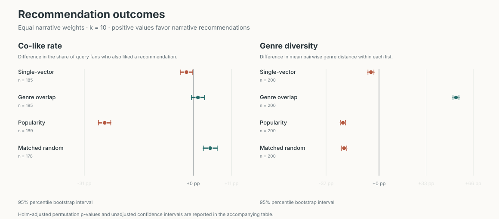
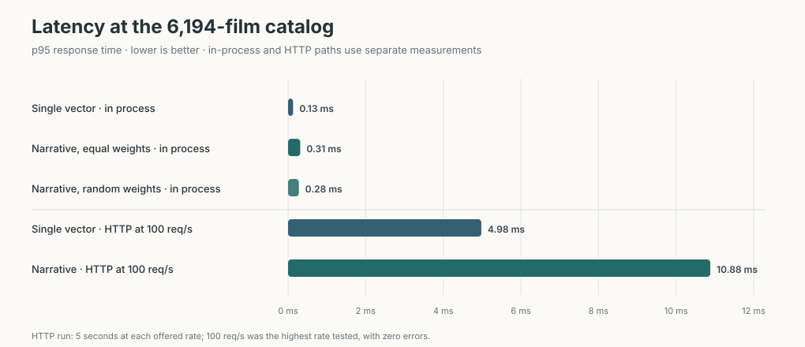
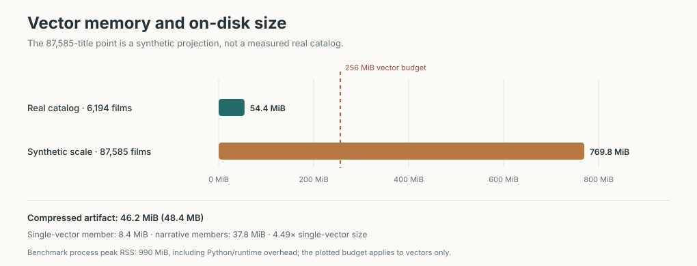

# Real-data evaluation: narrative movie recommender

**Run date:** 2026-11-19  ·  **Source:** `main` at `40783b1`  ·  **Machine:** COMECH-2080

## Result

The real 6,194-film catalog is well inside the current serving budgets: the measured in-process p95 is below 1 ms, the HTTP path stayed below 13 ms through the highest tested rate of 100 requests/second, and the six resident vector arrays use 54.4 MiB against a 256 MiB vector budget. The multi-vector artifact adds useful genre diversity and beats rating-count-matched random recommendations, but this run does not establish a quality improvement over the single-vector or genre-only baselines. Popularity remains much stronger on the co-like metric.

The broader 87,585-title capacity point is synthetic. It projects 769.8 MiB of resident vectors, so the 256 MiB memory target would require a storage/loading strategy change at that scale. Its measured array-search latency is still low, but it is not a real full-catalog validation.

## Data and run

- Catalog: **6,194 films** with **6,194 labels** already available; the evaluator loaded **29,782,953 MovieLens ratings**.
- Quality evaluation: 200 query films, equal narrative weights; swept `k` values 10, 5, 20 and 10 random weight profiles (47 profile/`k` cells total).
- A co-like outcome means the share of people who rated the seed at least 4/5 and also rated the recommendation at least 4/5. The evaluator requires at least 30 shared ratings.
- Pairwise differences are narrative minus baseline. Intervals are 95% percentile bootstrap intervals; p-values are two-sided sign-flip permutation tests with Holm correction within the headline family. The number of valid seed pairs differs by metric and baseline.
- The Qwen2.5-3B annotations pre-date this benchmark. This run did not fine-tune model weights: it reused the baseline MiniLM vectors and rebuilt the five narrative embedding dimensions from existing labels in 50.6 seconds (8.17 ms per film).

## Quality: equal weights, `k=10`

| Baseline | Paired `n` | Co-like difference (95% CI) | Holm adjusted `p` |
|---|---:|---:|---:|
| Single-vector | 185 | -1.90 pp (-3.54, -0.26) | 0.0552 |
| Genre overlap | 185 | +1.35 pp (-0.48, +3.22) | 0.1615 |
| Popularity | 189 | -25.05 pp (-26.78, -23.33) | 0.0008 |
| Rating-count-matched random | 178 | +4.83 pp (+2.87, +6.79) | 0.0008 |

The point estimate versus single-vector is −1.90 percentage points; its unadjusted interval is below zero, but the Holm-adjusted p-value is 0.0552, just above the 0.05 familywise threshold. Narrative versus genre overlap is inconclusive (`p=0.1615`). Narrative exceeds the rating-count-matched random baseline by 4.83 points (`p=0.0008`) and trails popularity by 25.05 points (`p=0.0008`). Read the adjusted p-values for significance decisions; the displayed intervals are not multiplicity-adjusted.

For genre diversity, narrative minus single-vector is **−5.64 pp** (Holm `p=0.0008`), narrative minus genre overlap is **+53.88 pp** (`p=0.0008`), and narrative is less diverse than both popularity and matched random by about **25 pp**. This shows a trade-off: the narrative representation is much broader than a genre match, while single-vector recommendations are slightly more diverse in this sample.



## Serving cost and capacity

| Measurement | Result |
|---|---:|
| Serial single-vector p95, `k=10` | 0.129 ms |
| Serial narrative, equal weights p95, `k=10` | 0.314 ms |
| Serial narrative, random weights p95, `k=10` | 0.278 ms |
| HTTP single-vector p95 at 100 offered req/s | 4.98 ms |
| HTTP narrative p95 at 100 offered req/s | 10.88 ms |
| Six vector arrays in memory, actual catalog | 54.4 MiB |
| Compressed `.npz` artifact | 46.2 MiB (48.4 MB) |
| Peak benchmark-process RSS | 990 MiB, including runtime overhead |

The HTTP load test offered 5, 20, 50, and 100 requests/second for five seconds each and had zero errors in both modes. **100 requests/second is the highest rate tested, not a measured saturation limit.** The server was reached over its own Tailscale address, so this includes HTTP and queueing but not WAN latency from another machine.

The vector budget passes on the real catalog. The benchmark estimates only **29,127** titles fit under 256 MiB when all six 384-dimensional float32 arrays are resident. The 87,585-title point and its 769.8 MiB vector requirement are generated from synthetic vectors; no semantic quality claim is made at that scale.





## Qualitative samples

[`output_samples.json`](output_samples.json) contains 8 seed films, each with top-five single-vector and equal-weight narrative recommendations and the existing Qwen labels for the seeds and recommendations. It is intended for the teammate's output review; it contains no user-level rating rows.

## Limits

- Offline cosine-search timings are array-search microbenchmarks; they exclude model inference, index/network fetches, and cold process startup.
- The HTTP run used short five-second rate windows on the same host as the server and stopped at 100 offered requests/second. It should not be read as an external-client or saturation test.
- Only the 6,194-title catalog uses real movie records and labels. Larger scaling rows use synthetic vectors; the memory projection is useful for sizing but not a substitute for measuring a real expanded catalog.
- The current relevance metric is a MovieLens co-like proxy, not a user study or a measure of narrative coherence. The qualitative samples are provided for human inspection.

## Reproduction

On COMECH-2080, with the project environment and the web app running in a second shell:

```sh
bin/web --host 127.0.0.1 --port 8765
# In another shell:
bin/reconstruct build --input data/processed/movie_lens_labels.jsonl --output artifacts/movie_embeddings.npz
bin/evaluate --queries 200 --k 10 5 20 --random-profiles 10 --resamples 10000 --output reports/evaluation.json
bin/reconstruct benchmark --artifact artifacts/movie_embeddings.npz --queries 500 --report reports/reconstruction_benchmark.json
bin/loadtest --url http://127.0.0.1:8765 --artifact artifacts/movie_embeddings.npz --modes single multi --rates 5 20 50 100 --duration 5 --workers 128 --timeout 10 --report reports/loadtest.json
python -m trainer.render_real_data_report
```

The generated report source is [`trainer/render_real_data_report.py`](../trainer/render_real_data_report.py).
